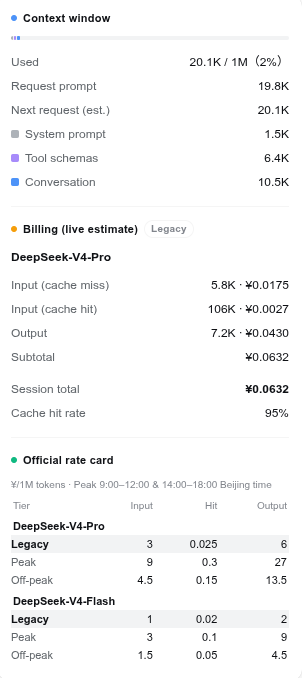

[中文](./README.zh-CN.md)

# dsh-client-ui-usage

A client (web UI) plugin for **DeepSeek Harness** (DSH) that puts a live
**context-window occupancy meter** and a real-time **billing estimate** into
the session header. One compact pill shows how full the context window is and
how much the current session is costing; clicking it opens a detail panel that
breaks both figures down.

- Package name: `@deepseek-ai/dsh-client-ui-usage`
- Version: `0.1.0-rc.6`
- Type: DSH client plugin (platform `web`)
- License: MIT

## Features

- **Context occupancy at a glance** — a mini progress bar plus a
  `used / window` token readout (e.g. `12.4K/128K`) in the session header,
  fed by the `contextPressure` projection.
- **Per-model live billing estimate** — tokens are attributed to the model that
  actually produced them (`deepseek-v4-pro` vs `deepseek-v4-flash` are billed
  **separately** at their own rates), so a pro session is never charged at
  flash prices. Switchable tabs let you view one model's detail at a time,
  with a combined **session total** (汇总) always visible.
- **Streaming pulse** — a pulsing dot in the pill while the model is
  responding.
- **Detail panel** — click the pill to open a dialog with:
  - Context window section: used / total, the current request's prompt size,
    the next-request projection, and a color-coded breakdown of
    system prompt / tool schemas / conversation.
  - Billing section: switchable per-model tabs (one model's buckets and
    subtotal at a time — cache-miss input, cache-hit input, output), plus the
    always-visible combined session total and the overall cache hit rate.
  - Official rate card (收费标准): DeepSeek's official CNY list prices for
    both models across all three tiers (current list / peak / off-peak),
    with the active tier highlighted.
- **Peak / off-peak indicator** — the current rate tier is shown as a badge in
  the pill and panel (`现行` / `高峰` / `空闲`), so you always know whether
  you are in a peak billing window.
- **Bilingual UI** — English and Chinese dictionaries are bundled and follow
  the DSH locale setting.
- **Accessible** — the pill carries a full ARIA label and the panel is a
  proper `role="dialog"` with Escape / outside-click dismissal.

## Screenshots

The compact usage pill in the session header:


Clicking the pill opens the detail panel with the context-window and
per-model billing breakdown:



## How it works

The plugin is a pure UI surface. The host half (`lib/index.js`) is an empty
`apply` so the package shows up in the DSH loader tree; the browser half
(`lib/client.js`) is discovered through the `dsh.client` declaration in
`package.json` and served by DSH at
`/plugins/@deepseek-ai/dsh-client-ui-usage/client.js`. It injects the
`UsageMeter` component into the `conversation.session.header.utilities` slot
and reads three session projections plus the trajectory view's settled
assistant nodes:

| Source | Purpose |
| --- | --- |
| `contextPressure` | Projected context tokens / window capacity → occupancy percent. |
| `contextBreakdown` | system / tools / messages token split for the panel bar. |
| `tokenUsage` | Full-session aggregate (used only to flag unloaded older history). |
| trajectory `eventNodes` | Per-message `usage` + `provenance.model` → per-model billing. |

**Billing is an estimate and is split per model.** DSH records
provider-reported tokens but no prices, so the plugin multiplies each
assistant message's token buckets by the official DeepSeek CNY list price of
the model that produced that message (¥/1M tokens), then sums per model and
across models. Legacy flat rates apply until `2026-08-17 00:00` Beijing time;
afterwards peak/off-peak rates apply by Beijing hour (peak `9:00–12:00` and
`14:00–18:00`, otherwise off-peak). Cache writes are billed at the cache-miss
input rate, matching DeepSeek. The per-model source is the trajectory view's
`eventNodes` (each settled assistant node carries both its final `usage` and
its `provenance.model`); the chat `legacy.nodes` are used only as a fallback
when the trajectory view is unavailable.

## Installation

### Prerequisites

- The `dsh` CLI is installed and the `web` profile has been initialized
  (run `dsh web` once; it auto-creates `$DSH_HOME/profiles/web`).
- The plugin runs in the browser, so the DSH **web** UI is required.

> This plugin is currently developed locally and is **not published to npm**.
> Use the local install below. Once it is published, the registry method also
> applies.

### Method A — Local install (recommended, works today)

1. Make the package resolvable from the web profile's loader — either a
   symlink or a plain copy into the profile's `node_modules`:

   ```sh
   DSH_HOME="${DSH_HOME:-$HOME/.dsh}"
   PROFILE="$DSH_HOME/profiles/web"
   mkdir -p "$PROFILE/node_modules/@deepseek-ai"

   # symlink keeps the plugin updated in place (recommended while developing):
   ln -s "$PWD/DeepSeek Harness/plugins/dsh-client-ui-usage" \
     "$PROFILE/node_modules/@deepseek-ai/dsh-client-ui-usage"

   # or copy it:
   # cp -r "DeepSeek Harness/plugins/dsh-client-ui-usage" \
   #   "$PROFILE/node_modules/@deepseek-ai/dsh-client-ui-usage"
   ```

2. Enable the plugin in the loader patch layer — append an insert entry to
   the profile's `cordis.patch.yml` (this is the file DSH applies after every
   bundle layer; `cordis.yml` itself is generated and must not be edited):

   ```yaml
   # ~/.dsh/profiles/web/cordis.patch.yml
   - insert:
       - id: ui-usage
         name: '@deepseek-ai/dsh-client-ui-usage'
   ```

3. Restart the web UI and verify:

   ```sh
   dsh web
   ```

   Open the UI (default `http://127.0.0.1:3080`, or the port you passed,
   e.g. `dsh --profile web --port 8080`). The usage pill appears in the
   session header once the session has any activity. You can also confirm the
   entry is loaded in Settings → Plugins (inventory), or that
   `/plugins/@deepseek-ai/dsh-client-ui-usage/client.js` returns `200`.

### Method B — Registry install (once published)

```sh
# install the package into the web profile's node_modules
dsh plugin --profile web add @deepseek-ai/dsh-client-ui-usage
```

Then enable it with the same `cordis.patch.yml` insert entry as in Method A,
and restart `dsh web`.

## Usage

No configuration is required — the plugin is a pure UI surface.

1. Start a session in the DSH web UI. Once the first message lands, the
   **usage pill** shows in the session header:
   - a mini occupancy bar and `used / window` tokens (e.g. `12.4K/128K`),
   - the running cost estimate (e.g. `¥0.1234`), or `—` until usage exists.
2. While the model streams a turn, a small **pulse dot** appears in the pill.
3. **Hover** the pill for a one-line tooltip summary; **click** it to open
   the detail panel:
   - *Context window* — used/total and percent, current request prompt,
     next-request estimate, and the system / tools / messages split with its
     color legend.
   - *Billing (live estimate)* — uncached / cache-hit input and output tokens
     with per-bucket costs, the session total, cache hit rate, and the active
     rate tier (current list price / peak / off-peak).
4. Click outside or press `Esc` to close the panel.

The numbers update live as requests stream and usage reports land. Treat the
billing figure as an **estimate** — DSH records tokens only, and the price
table (DeepSeek official CNY list prices) may change over time.

## Compatibility

- DeepSeek Harness web profile (`dsh web`).
- Browser side requires the DSH client runtime, locale, and conversation UI
  surfaces (declared as `dsh.client.inject` in `package.json`).
- Peer dependencies: `react ^18.2.0` and
  `@deepseek-ai/dsh-client-ui-primitives ^0.1.0-rc.6`.

## Project structure

```
dsh-client-ui-usage/
├── LICENSE              # MIT
├── README.md            # this file
├── README.zh-CN.md      # 中文说明
├── package.json         # dsh.client declaration, exports, peer deps
├── docs/
│   └── images/          # UI screenshots (common/ universal, en/ + zh/ per locale)
└── lib/
    ├── index.js         # host half — empty apply (registers in the loader)
    └── client.js        # browser half — UsageMeter component + zh/en locales
```

## License

MIT — see [LICENSE](./LICENSE).
