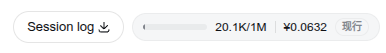
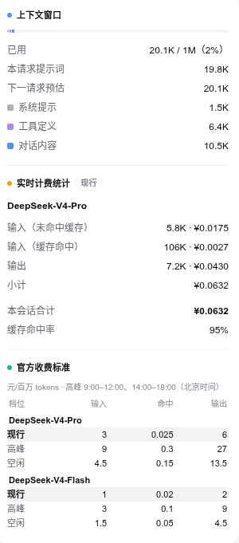

[English](./README.md)

# dsh-client-ui-usage

面向 **DeepSeek Harness**（DSH）的客户端（Web UI）插件，在会话头部提供实时
**上下文窗口占用率**与**计费估算**。一个紧凑的胶囊组件即可展示上下文窗口的占用
程度与当前会话的花费；点击后弹出详情面板，对两项数据进行细分。

- 包名：`@deepseek-ai/dsh-client-ui-usage`
- 版本：`0.1.0-rc.6`
- 类型：DSH 客户端插件（platform `web`）
- 许可证：MIT

## 功能特性

- **上下文占用一目了然** — 会话头部显示迷你进度条与 `已用 / 窗口` tokens 读数
  （如 `12.4K/128K`），数据来自 `contextPressure` 投影。
- **实时计费估算（按模型分账）** — 每笔 tokens 都归属到实际产生它的模型
  （`deepseek-v4-pro` 与 `deepseek-v4-flash` **分别**按各自费率计费），因此 pro
  会话绝不会被按 flash 价格计费。通过切换按钮可一次只查看一个模型的明细，
  并始终显示合并的**本会话合计**（汇总）。
- **流式脉冲指示** — 模型回复期间，胶囊内显示脉动小圆点。
- **详情面板** — 点击胶囊弹出对话框，包含：
  - 上下文窗口区：已用/总量、当前请求提示词大小、下一请求预估，以及系统提示 /
    工具定义 / 对话内容的配色细分。
  - 计费区：可切换的模型标签页（一次只显示一个模型的计费桶与小计——输入·
    未命中缓存、输入·命中缓存、输出），以及始终可见的合并
    会话合计与整体缓存命中率。
  - 官方收费标准：两种模型在三个档位（现行刊例价 / 高峰 / 空闲）下的 DeepSeek
    官方人民币刊例价，并高亮当前档位。
- **高峰/空闲标记** — 胶囊与面板中都以徽标标注当前计费档位（`现行` / `高峰` /
  `空闲`），随时可知是否处于高峰计费时段。
- **双语界面** — 内置英文与中文词典，跟随 DSH 语言设置。
- **无障碍支持** — 胶囊带完整 ARIA 标签，面板为标准 `role="dialog"`，支持
  Escape / 点击外部关闭。

## 效果图

会话头部的简洁用量胶囊：



点击胶囊可展开详情面板，查看上下文窗口与按模型分账的计费明细：



## 工作原理

本插件是纯 UI 插件。宿主端（`lib/index.js`）为空 `apply`，仅用于让包出现在 DSH
loader 树中；浏览器端（`lib/client.js`）通过 `package.json` 中的 `dsh.client`
声明被 DSH 发现，并由 DSH 在 `/plugins/@deepseek-ai/dsh-client-ui-usage/client.js`
提供服务。它把 `UsageMeter` 组件注入 `conversation.session.header.utilities`
插槽，并读取三个会话投影以及 trajectory 视图的已结算 assistant 节点：

| 数据来源 | 用途 |
| --- | --- |
| `contextPressure` | 预估上下文 tokens / 窗口容量 → 占用百分比。 |
| `contextBreakdown` | 系统 / 工具 / 消息 tokens 细分，用于面板进度条。 |
| `tokenUsage` | 全会话汇总（仅用于提示尚未加载的较早历史）。 |
| trajectory `eventNodes` | 每条消息的 `usage` + `provenance.model` → 按模型分账。 |

**计费为估算值，且按模型分账。** DSH 只记录 provider 上报的 tokens，不记录价格，
因此插件将每条 assistant 消息的 token 桶乘以其实际产生模型的 DeepSeek 官方人民币
刊例价（元/百万 tokens），再分别按模型汇总、跨模型求和。`2026-08-17 00:00`（北京
时间）之前适用现行刊例价（legacy 统一费率）；之后按北京时间启用峰谷价：高峰
`9:00–12:00`、`14:00–18:00`，其余为空闲价。按模型分账的数据来源是 trajectory
视图的 `eventNodes`（每条已结算的 assistant 节点同时携带最终 `usage` 与
`provenance.model`）；chat 的 `legacy.nodes` 仅在 trajectory 视图不可用时作为回退。

## 安装方法

### 前置条件

- 已安装 `dsh` CLI，且 `web` profile 已初始化（至少运行过一次 `dsh web`，它会
  自动创建 `$DSH_HOME/profiles/web`）。
- 插件运行在浏览器中，因此需要 DSH 的 **web** UI。

> 该插件目前为本地开发状态，**尚未发布到 npm**。请使用下面的本地安装方式；
> 发布后同样适用 registry 安装方式。

### 方式 A — 本地安装（推荐，当前可用）

1. 让包对 web profile 的 loader 可见 —— 在 profile 的 `node_modules` 下创建
   符号链接或直接复制：

   ```sh
   DSH_HOME="${DSH_HOME:-$HOME/.dsh}"
   PROFILE="$DSH_HOME/profiles/web"
   mkdir -p "$PROFILE/node_modules/@deepseek-ai"

   # 符号链接可在开发时原地同步更新（推荐）：
   ln -s "$PWD/DeepSeek Harness/plugins/dsh-client-ui-usage" \
     "$PROFILE/node_modules/@deepseek-ai/dsh-client-ui-usage"

   # 或者直接复制：
   # cp -r "DeepSeek Harness/plugins/dsh-client-ui-usage" \
   #   "$PROFILE/node_modules/@deepseek-ai/dsh-client-ui-usage"
   ```

2. 在 loader 补丁层启用插件 —— 向 profile 的 `cordis.patch.yml` 追加一条
   insert 记录（该文件在每一层 bundle 之后应用；`cordis.yml` 是自动生成的，
   请勿直接编辑）：

   ```yaml
   # ~/.dsh/profiles/web/cordis.patch.yml
   - insert:
       - id: ui-usage
         name: '@deepseek-ai/dsh-client-ui-usage'
   ```

3. 重启 Web UI 并验证：

   ```sh
   dsh web
   ```

   打开界面（默认 `http://127.0.0.1:3080`，或你指定的端口，如
   `dsh --profile web --port 8080`）。会话产生任意活动后，会话头部即会出现
   用量胶囊。也可以到 设置 → 插件（inventory）中确认条目已加载，或确认
   `/plugins/@deepseek-ai/dsh-client-ui-usage/client.js` 返回 `200`。

### 方式 B — Registry 安装（发布后可用）

```sh
# 将包安装到 web profile 的 node_modules
dsh plugin --profile web add @deepseek-ai/dsh-client-ui-usage
```

然后按方式 A 中同样的 `cordis.patch.yml` insert 记录启用插件，并重启
`dsh web`。

## 使用方法

无需任何配置 —— 本插件是纯 UI 插件。

1. 在 DSH Web UI 中开始一个会话。第一条消息产生后，会话头部会出现**用量
   胶囊**：
   - 迷你占用进度条与 `已用 / 窗口` tokens（如 `12.4K/128K`）；
   - 实时费用估算（如 `¥0.1234`），暂无用量数据时显示 `—`。
2. 模型流式回复期间，胶囊内会显示**脉动小圆点**。
3. **悬停**胶囊可查看一行摘要提示；**点击**可展开详情面板：
   - *上下文窗口* — 已用/总量与百分比、当前请求提示词、下一请求预估，以及
     系统 / 工具 / 消息的配色细分。
   - *实时计费统计* — 未命中缓存 / 命中缓存的输入与输出 tokens 及
     各自费用、会话合计、缓存命中率、当前计费档位（现行刊例价 / 高峰 / 空闲）。
4. 点击面板外部或按 `Esc` 关闭面板。

所有数字都会在请求流式输出与用量上报到达时实时更新。请将计费数字视为
**估算值** —— DSH 仅记录 tokens，价目表（DeepSeek 官方人民币刊例价）可能随
时间变化。

## 兼容性

- DeepSeek Harness web profile（`dsh web`）。
- 浏览器端需要 DSH 客户端运行时、语言包与对话 UI 表面（在 `package.json` 中以
  `dsh.client.inject` 声明）。
- 对等依赖：`react ^18.2.0` 与 `@deepseek-ai/dsh-client-ui-primitives
  ^0.1.0-rc.6`。

## 项目结构

```
dsh-client-ui-usage/
├── LICENSE              # MIT
├── README.md            # 英文说明
├── README.zh-CN.md      # 本文件（中文说明）
├── package.json         # dsh.client 声明、exports、对等依赖
├── docs/
│   └── images/          # 界面效果图（common/ 通用，en/ 与 zh/ 按语言区分）
└── lib/
    ├── index.js         # 宿主端 —— 空 apply（注册进 loader）
    └── client.js        # 浏览器端 —— UsageMeter 组件 + 中英文语言包
```

## 许可证

MIT —— 参见 [LICENSE](./LICENSE)。
